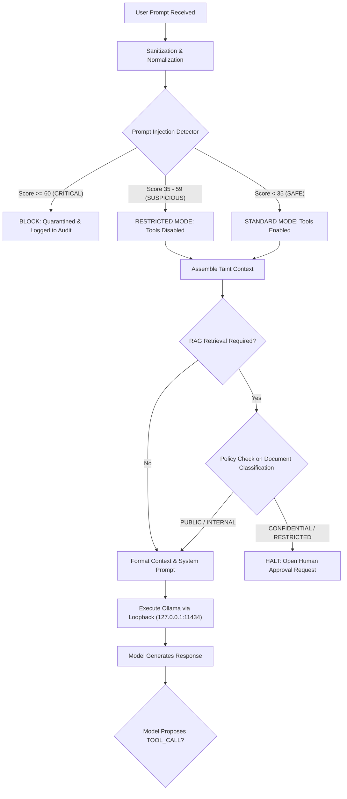
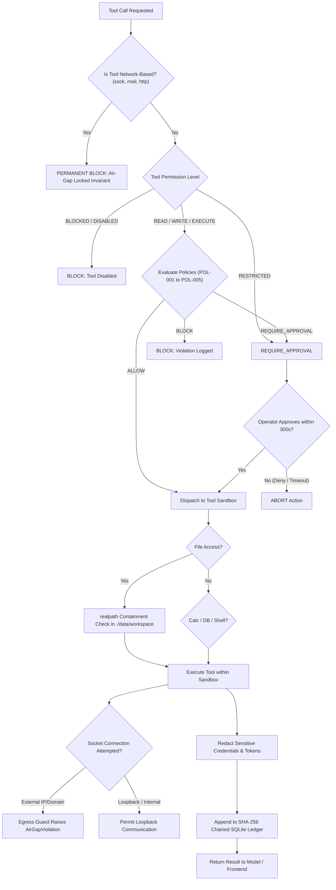

# 02 — System Architecture

## 1. High-Level Blueprint

Clarix AI is split into two primary layers: a modern React-based security console and a hardened Python/FastAPI backend backed by local SQLite and loopback Ollama inference.

```
+-----------------------------------------------------------------------------------+
|                              LOCAL BROWSER WORKSTATION                             |
|                                                                                   |
|  +-----------------------------------------------------------------------------+  |
|  |             Clarix AI Security Console (React 18 + TypeScript + Vite)        |  |
|  |                                                                             |  |
|  |  +---------------------+  +----------------------+  +--------------------+  |  |
|  |  | 17 Console Modules  |  |  Hover Drawer Nav    |  | Web Crypto Verify  |  |  |
|  |  | (Agent, RAG, etc.)  |  |  State Machine       |  | (Client SHA-256)   |  |  |
|  |  +---------------------+  +----------------------+  +--------------------+  |  |
|  |             |                                                  ^            |  |
|  |             v                                                  |            |  |
|  |  +-----------------------------------------------------------------------+  |  |
|  |  |                      API Client & State Router                        |  |  |
|  |  |  (VITE_USE_MOCKS: switches between mock/db.ts and REST backend API)  |  |  |
|  |  +-----------------------------------------------------------------------+  |  |
|  +---------------------------------------|-------------------------------------+  |
+------------------------------------------|----------------------------------------+
                                           | HTTP JSON (127.0.0.1:8000)
                                           v
+-----------------------------------------------------------------------------------+
|                        LOCAL CLARIX BACKEND (Python 3.10+)                        |
|                                                                                   |
|  +-----------------------------------------------------------------------------+  |
|  |                   FastAPI / Uvicorn Server / Stdlib Fallback                |  |
|  |                     (Auth Tokens, Rate Limiting, CORS)                      |  |
|  +-----------------------------------------------------------------------------+  |
|                                          |                                        |
|  +-----------------------------------------------------------------------------+  |
|  |                             SECURITY PIPELINE                               |  |
|  |                                                                             |  |
|  |  [Prompt Ingress] ---> [Injection Screening] ---> [Taint & Data Context]    |  |
|  |                                                               |             |  |
|  |  [Tool Sandbox]  <--- [Human Approval CAS]  <--- [Policy Engine POL-001..5] |
|  +-----------------------------------------------------------------------------+  |
|            |                             |                             |          |
|            v                             v                             v          |
|  +--------------------+       +--------------------+        +------------------+  |
|  |   Egress Guard     |       |   RAG Engine &     |        | SQLite Ledger    |  |
|  |   Socket Hook      |       |   Document Store   |        | (SHA-256 Chain   |  |
|  |   (Zero Outbound)  |       |   (Dual Embedder)  |        |  & Triggers)     |  |
|  +--------------------+       +--------------------+        +------------------+  |
|            |                             |                             |          |
|            v                             v                             v          |
|    BLOCKED WITH ERROR          Loopback HTTP (11434)            ./data/clarix.db  |
|                                          |                                        |
+------------------------------------------|----------------------------------------+
                                           v
+-----------------------------------------------------------------------------------+
|                             OLLAMA LOCAL LLM ENGINE                               |
|                                                                                   |
|           Models: Llama 3 / Mistral  *  Embeddings: nomic-embed-text             |
|                               Bind: 127.0.0.1:11434                               |
+-----------------------------------------------------------------------------------+
                                           |
+-----------------------------------------------------------------------------------+
|                     HOST OPERATING SYSTEM SECURITY BOUNDARY                       |
|                                                                                   |
|      * Linux: iptables / nftables drop external TCP/UDP/DNS                       |
|      * macOS: pf packet filter blocks WAN egress                                  |
|      * Systemd: IPAddressDeny=any, ProtectSystem=strict, PrivateTmp=true          |
+-----------------------------------------------------------------------------------+
```

---

## 2. Dual-Engine Architecture: Mock vs. Live

Clarix AI provides two operational modalities, controlled via the frontend environment variable `VITE_USE_MOCKS`:

### 1. Mock Mode (`VITE_USE_MOCKS=true`)
* **Purpose**: Self-contained demonstration, UI/UX evaluation, sales reviews, and disconnected testing without needing Python, FastAPI, or Ollama running.
* **Implementation**: Uses `src/services/mock/db.ts` to simulate all 17 console pages in the browser.
* **Visual Safeguard**: The UI displays a persistent **"SIMULATED DATA"** badge and indicator pills to avoid misrepresenting simulation as live security boundaries.
* **Browser-side Cryptography**: Even in mock mode, the SHA-256 hash-chain verification runs real cryptographic routines using the browser's native Web Crypto API.

### 2. Live Mode (`VITE_USE_MOCKS=false`)
* **Purpose**: Real air-gapped deployment with real policy enforcement, real model inference, real file sandboxing, and real tamper-evident auditing.
* **Configuration**: Directs API requests to `VITE_API_URL=http://127.0.0.1:8000`.
* **Telemetry**: Measures real OS memory, CPU, disk posture, and actual network egress attempts.

---

## 3. Data Flow & Security Pipelines

### A. Ingress Request Flow (Prompt Execution)



### B. Egress & Tool Execution Flow



---

## 4. Trust Boundaries & Isolation Layers

1. **Zone 0 (External WAN / Internet)**: Untrusted, completely disconnected. No network interface communicates with Zone 0.
2. **Zone 1 (Host OS & Network Stack)**: Protected by OS packet filters (`iptables`, `nftables`, `pf`). Only loopback interface (`lo` / `127.0.0.1`) is active.
3. **Zone 2 (Application Runtime & Services)**: The FastAPI service, SQLite database, and Ollama service run as dedicated unprivileged system users.
4. **Zone 3 (Sandbox Workspace)**: `./data/workspace` is the strictly isolated filesystem sandbox where the agent is permitted to read and write non-sensitive artifacts.
5. **Zone 4 (AI Model Reasoning)**: Untrusted compute zone. All model inputs are sanitized; all outputs are treated as unverified proposals until validated by policy and sandbox rules.
